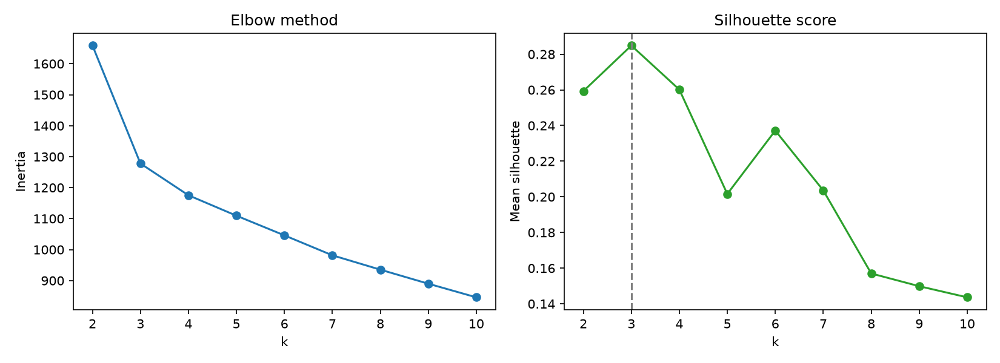
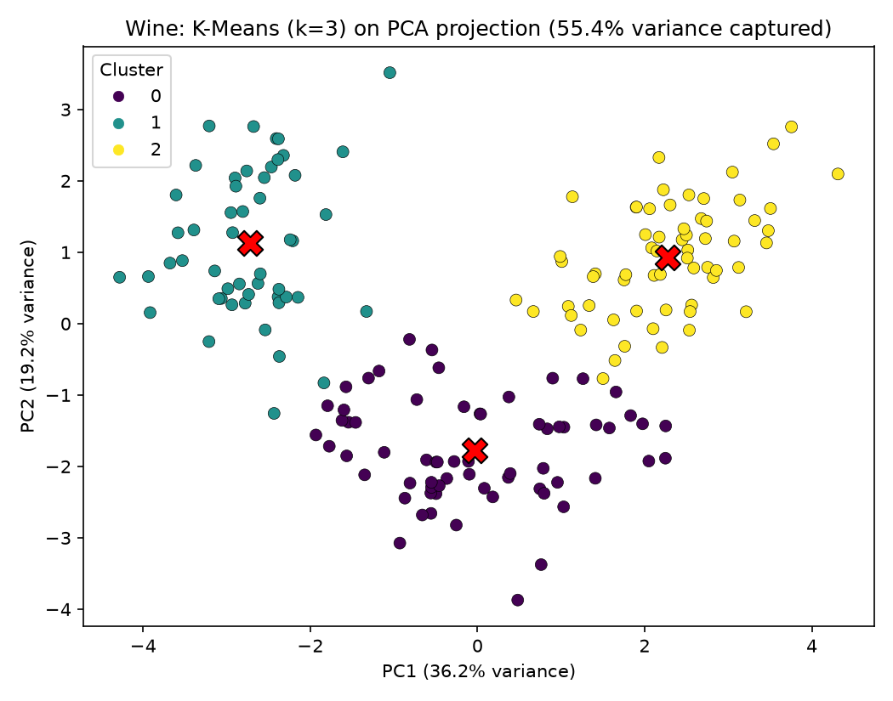

# ML-3: Unsupervised Learning — K-Means + PCA on the Wine Dataset

Finds structure in unlabeled chemical-analysis data of 178 Italian wines (13 numeric features).
The `target` (cultivar) column is **dropped before any modeling**; it is only used at the very end
as a post-hoc sanity check.

## Run it
```bash
pip install -r requirements.txt
python analysis.py
```
Outputs: `figures/elbow_silhouette.png`, `figures/pca_clusters.png`, `cluster_profiles.csv`, plus console logs.

## Pipeline
1. **Data**: `sklearn.datasets.load_wine` — 178 samples × 13 features, labels hidden.
2. **Scaling**: `StandardScaler` (proline is in the hundreds/thousands, hue is ~1 — unscaled, proline would dominate distances).
3. **Choosing k** (k = 2…10, `n_init=10`, `random_state=42`):

| k | Inertia | Silhouette |
|---|---------|-----------|
| 2 | 1658.8 | 0.259 |
| **3** | **1277.9** | **0.285** |
| 4 | 1175.4 | 0.260 |
| 5 | 1109.5 | 0.202 |
| 6 | 1046.0 | 0.237 |
| 7 | 981.6 | 0.204 |
| 8 | 935.2 | 0.157 |
| 9 | 889.9 | 0.150 |
| 10 | 845.9 | 0.144 |

   Silhouette peaks at **k = 3**, and the inertia curve has its clearest bend at k = 3
   (large drop 2→3, much gentler afterward). Both methods agree. Note the silhouette is modest
   (0.285) — the clusters are real but not perfectly separated.

   

4. **Final model**: K-Means with k = 3 → cluster sizes 65 / 51 / 62.
5. **PCA** (2 components, fit on the same scaled data):
   - PC1: **36.2%** of variance
   - PC2: **19.2%**
   - **Total captured by the 2D projection: 55.4%.** The remaining ~45% is lost in the plot, so
     overlap between clusters in 2D may be partly a projection artifact. (3 PCs would reach 66.5%; 8 PCs ≈ 92%.)

   

## Interpretation: what are the clusters?
Cluster means below are z-scores (0 = dataset average; ±1 = one standard deviation). Raw-unit means are in `cluster_profiles.csv`.

| Feature | Cluster 0 | Cluster 1 | Cluster 2 |
|---|---|---|---|
| alcohol | −0.93 | 0.16 | **0.84** |
| proline | −0.75 | −0.41 | **1.13** |
| flavanoids | 0.02 | **−1.22** | **0.98** |
| total phenols | −0.08 | **−0.98** | **0.89** |
| od280/od315 | 0.27 | **−1.29** | 0.78 |
| color intensity | **−0.90** | **0.94** | 0.17 |
| hue | 0.46 | **−1.16** | 0.47 |
| malic acid | −0.39 | **0.87** | −0.30 |

- **Cluster 2 — "full-bodied, high-alcohol, phenol-rich" wines (n=62).** Highest alcohol (13.7%), by far the highest
  proline (~1100 vs ~510–620), high flavanoids/phenols, and the lowest alcalinity of ash. Example: sample 0
  (14.23% alcohol, proline 1065, flavanoids 3.06).
- **Cluster 1 — "dark, acidic, low-phenol" wines (n=51).** Very high color intensity (7.2) and malic acid (3.3),
  very low flavanoids (0.82), low hue and low OD280/OD315 (diluted-wine protein/phenol proxy). Example: sample 83
  (malic acid 3.86, flavanoids 1.59, hue 0.84).
- **Cluster 0 — "light, low-alcohol, pale" wines (n=65).** Lowest alcohol (12.3%) and lowest color intensity (3.0),
  low proline, but average phenols/flavanoids and relatively high hue. Example: sample 59 (12.37% alcohol, color 1.95).

**PCA reading:** PC1 is largely a "phenolic content" axis (flavanoids .42, total phenols .39, OD280 .38 positive;
nonflavanoid phenols −.30, malic acid −.25 negative) — it separates Cluster 1 from the rest. PC2 is driven by
color intensity (.53), alcohol (.48) and proline (.36) — it separates Cluster 0 (low) from Cluster 2 (high).

**Real-world meaning:** the dataset comes from three grape cultivars grown in one Italian region. Without ever seeing
the cultivar label, K-Means recovered groups that differ in the chemical signatures that distinguish wine styles
(alcohol/body, phenolic richness, color/acidity).

## Post-hoc sanity check (labels used only here)
| K-Means cluster | Cultivar 0 | Cultivar 1 | Cultivar 2 |
|---|---|---|---|
| 0 | 0 | 65 | 0 |
| 1 | 0 | 3 | 48 |
| 2 | 59 | 3 | 0 |

Adjusted Rand Index = **0.897** — clusters closely match the true cultivars (only 6 of 178 samples
land in a different group than their majority cultivar). Cluster IDs are arbitrary, so numbering doesn't line up with cultivar numbering.

## Limitations
- 2D PCA shows only 55.4% of variance; clusters were fit in the full 13-D space, not on the PCA plot.
- Silhouette of 0.285 means moderate separation; some wines sit near cluster boundaries.
- K-Means assumes roughly spherical, similar-sized clusters; it worked well here but won't on every dataset.
